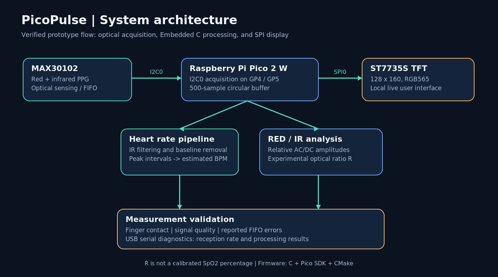
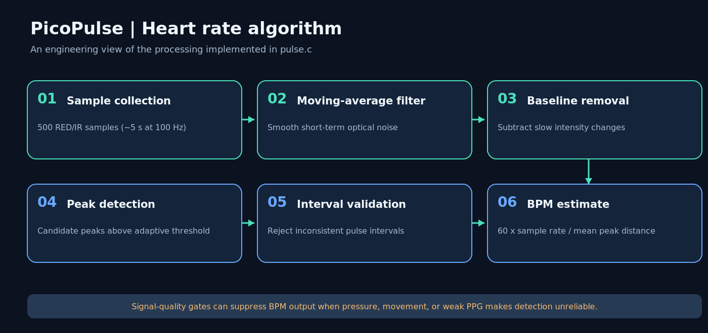
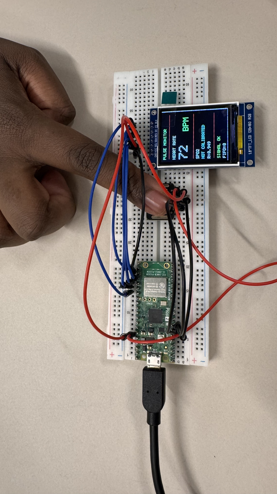
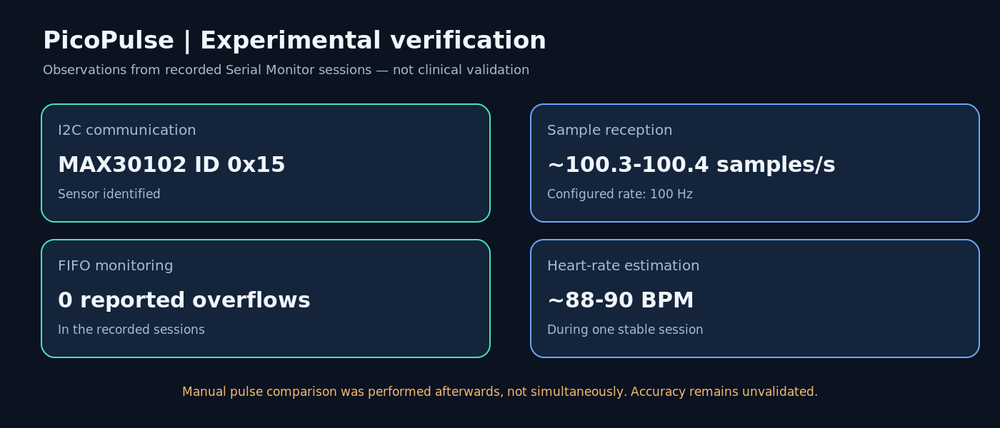

# PicoPulse — Embedded Optical Heart Rate Monitor

**A standalone optical heart rate monitoring prototype developed in Embedded C using Raspberry Pi Pico 2 W, MAX30102 and an ST7735S TFT display.**

**Technologies:** Embedded C · Raspberry Pi Pico SDK · I²C · SPI · PPG Signal Processing · Sensor Integration · Hardware Debugging

PicoPulse is a microcontroller-based system that acquires optical photoplethysmography (PPG) signals, processes sensor data to estimate heart rate in beats per minute (BPM), and displays the results on a local TFT screen.

The project combines **low-level firmware development, digital signal processing, hardware interfacing and embedded visualization** in a functional prototype.

It was developed to explore the engineering challenges of building a self-contained optical measurement system, from raw sensor communication to processed measurements and live graphical output.

---

## 1. The Engineering Challenge

Photoplethysmography is an optical sensing technique that detects changes in blood volume through variations in transmitted or reflected light.

Although the underlying principle is relatively straightforward, implementing a reliable optical measurement system involves several engineering challenges.

The PPG signal is sensitive to finger positioning, movement, contact pressure and noise. Meanwhile, the microcontroller must continuously acquire data, process incoming samples and update the display.

The main development objectives were to:

- Implement communication with the MAX30102 optical sensor using I²C.
- Acquire red and infrared measurements through the sensor FIFO.
- Develop signal-processing algorithms for extracting pulse information.
- Estimate heart rate from detected pulse intervals.
- Identify and suppress measurements affected by poor signal quality.
- Integrate an SPI-controlled TFT display.
- Develop modular and maintainable firmware in Embedded C.

The goal was to create a functional embedded system that performs sensing, processing and visualization without relying on an external computer.

---

## 2. The Solution — An Integrated Embedded System

PicoPulse uses the **Raspberry Pi Pico 2 W (RP2350)** as its central processing unit.

The MAX30102 captures red and infrared optical measurements, which are transferred to the microcontroller over I²C.

The firmware manages incoming samples using a fixed-size circular buffer and processes the infrared signal to estimate heart rate.

The results are displayed locally on an ST7735S TFT screen through SPI.

| Design Area | Implementation |
|---|---|
| Microcontroller | Raspberry Pi Pico 2 W (RP2350) |
| Optical sensor | MAX30102 |
| Programming language | Embedded C |
| Development framework | Raspberry Pi Pico SDK |
| Sensor interface | I²C0 |
| Display interface | SPI0 |
| Sampling configuration | 100 samples per second |
| Data management | 500-sample circular buffer |
| Signal processing | Smoothing, baseline removal and pulse peak detection |
| User interface | 1.8-inch ST7735S TFT, 128 × 160 pixels |
| Diagnostics | USB serial output and sensor FIFO monitoring |

The system architecture separates hardware-specific communication from measurement processing and visualization.

---

## 3. System Architecture

The firmware follows a modular design in which sensor acquisition, measurement management, signal processing and user interface functions are implemented separately.



### Firmware Architecture

| Source Files (`src/`) | Header Files (`include/`) | Responsibility |
|---|---|---|
| `main.c` | — | System initialization and main execution flow |
| `max30102.c` | `max30102.h` | Sensor configuration, I²C communication and FIFO handling |
| `measurement.c` | `measurement.h` | Circular buffer and measurement statistics |
| `pulse.c` | `pulse.h` | Signal processing and BPM estimation |
| `spo2.c` | `spo2.h` | Experimental RED/IR ratio analysis |
| `display.c` | `display.h` | ST7735S display driver and SPI communication |
| `ui.c` | `ui.h` | User interface and visualization |

The project separates implementation files in `src/` from module interfaces in `include/`.

This architecture provides clear separation between the main subsystems and makes the firmware easier to inspect, test and extend.

### Hardware Communication

**MAX30102 — I²C0**

| Signal | Raspberry Pi Pico 2 W |
|---|---|
| SDA | GP4 |
| SCL | GP5 |
| VIN | 3V3(OUT) |
| GND | Common GND |

**ST7735S — SPI0**

| Signal | Raspberry Pi Pico 2 W |
|---|---|
| SCK | GP18 |
| MOSI | GP19 |
| CS | GP17 |
| DC | GP20 |
| RST | GP21 |
| VCC | 3V3(OUT) |
| GND | Common GND |

The TFT backlight connection depends on the specific display module and should be verified against its electrical specifications.

---

## 4. Signal Processing and Heart Rate Estimation

The MAX30102 is configured to acquire approximately **100 samples per second**.

The firmware maintains a **500-sample circular buffer**, corresponding to approximately five seconds of optical measurements.

The infrared channel is processed to detect periodic variations associated with cardiac activity.



### Signal Processing Pipeline

**1. Data Acquisition**

Red and infrared optical measurements are read from the MAX30102 sensor FIFO and transferred to the microcontroller.

**2. Noise Reduction**

A moving-average filter is applied to reduce short-term signal fluctuations.

**3. Baseline Removal**

Slowly varying components of the optical signal are reduced to emphasize the pulsatile waveform.

**4. Pulse Peak Detection**

Candidate pulse peaks are identified using signal thresholds and local waveform characteristics.

**5. Interval Validation**

The distances between detected peaks are analyzed to identify irregular measurements and reduce false BPM estimates.

**6. Heart Rate Estimation**

Heart rate is calculated from the mean interval between accepted pulse peaks.

**BPM = (60 × Sampling Frequency) / Average Peak Interval**

Where:

- **BPM** is the estimated heart rate in beats per minute.
- **Sampling Frequency** is the estimated sample reception rate in Hz.
- **Average Peak Interval** is the mean distance between accepted pulse peaks, measured in samples.

The firmware also evaluates signal quality before accepting BPM measurements.

### Experimental RED/IR Analysis

In addition to estimating heart rate, PicoPulse processes both optical channels to calculate an experimental ratio used in pulse oximetry research.

Each optical signal is separated into:

- **DC component:** The mean optical signal level.
- **AC component:** The pulsatile signal amplitude, estimated using baseline-removed RMS values.

The optical ratio is calculated as:

**R = (RED_AC / RED_DC) / (IR_AC / IR_DC)**

The ratio is used as an experimental optical measurement feature.

Converting the RED/IR ratio into a reliable oxygen saturation percentage requires additional calibration and validation.

---

## 5. Embedded Firmware and Engineering Decisions

Several implementation decisions were important to the development of PicoPulse.

### Modular Firmware Development

The firmware was implemented in Embedded C using the Raspberry Pi Pico SDK.

Sensor drivers, measurement storage, signal processing and graphical output are maintained in separate source modules.

This structure reduces coupling between system components and makes debugging and future development more manageable.

### Circular Buffer Management

A fixed-size circular buffer maintains the latest optical measurements.

This approach provides a predictable memory footprint and avoids the need for dynamic memory allocation during operation.

The buffer supports repeated processing of a recent measurement window while new samples continue to arrive.

### Measurement Quality Handling

Optical pulse measurements are affected by several conditions, particularly finger movement and inconsistent contact pressure.

The BPM algorithm includes checks based on signal characteristics and detected pulse intervals.

When the input signal does not satisfy the implemented conditions, the system can suppress the BPM estimate instead of displaying an unreliable measurement.

### Hardware Integration and Debugging

Development involved practical troubleshooting of sensor communication, breadboard connections, display initialization and signal disturbances.

One important integration issue involved the ST7735S display, which initially produced a white screen.

The issue was traced to a mismatch between the selected SPI peripheral and the configured GPIO connections.

Correcting the peripheral selection from SPI1 to SPI0 restored display communication and enabled successful graphical rendering.

This debugging process reinforced the importance of verifying both firmware peripheral configuration and physical hardware connections.

---

## 6. User Interface and Visualization

PicoPulse includes a local graphical interface implemented for the ST7735S TFT display.

The display driver handles SPI communication, RGB565 color output and bitmap text rendering.

The interface presents:

- Estimated heart rate in BPM.
- Experimental RED/IR optical ratio.
- Measurement and signal status.
- Detected sensor FIFO overflow events.

The display enables local operation without requiring a connected computer.

USB serial communication is available for additional diagnostics and inspection of sensor measurements during development.

### Physical Prototype

The assembled PicoPulse prototype integrates the Raspberry Pi Pico 2 W, MAX30102 optical sensor and ST7735S TFT display.


### TFT Display

The display presents heart rate estimates and measurement information directly on the device.



---

## 7. Prototype Verification

The prototype was tested during development to verify communication, sensor acquisition, signal processing and graphical output.



| Verified Function | Development Observation |
|---|---|
| Sensor communication | MAX30102 identification and register communication successful |
| Optical sensing | Red and infrared signals responded to finger contact |
| Data acquisition | Sample reception observed near the configured 100 Hz rate |
| FIFO diagnostics | No overflow events reported during recorded test sessions |
| BPM processing | Heart rate estimates produced during stationary measurements |
| Signal quality handling | Unreliable measurements can be suppressed |
| SPI display communication | Successful color rendering |
| Graphical user interface | Live measurements displayed on the TFT |
| Integrated operation | Sensor acquisition, signal processing and display operated together |

These tests verified the main functional components and demonstrated their integration into a working embedded prototype.

The development process also identified the influence of finger positioning and contact pressure on the measured optical waveform.

A more extensive measurement campaign would be required to quantify accuracy and repeatability.

---

## 8. Measurement Uncertainty and Future Improvements

Optical heart rate measurement systems are affected by several factors that influence signal quality, measurement uncertainty and repeatability.

Understanding these effects is important when evaluating sensor performance and designing reliable measurement systems.

### Sources of Measurement Uncertainty

| Source | Potential Effect |
|---|---|
| Finger positioning | Changes in optical coupling and signal amplitude |
| Contact pressure | Distortion of the PPG waveform and pulse amplitude |
| Motion artifacts | False peaks and irregular pulse intervals |
| Ambient light | Interference with optical measurements |
| Sensor noise | Reduced signal-to-noise ratio |
| Sampling and timing variations | Errors in estimated pulse intervals |
| Filtering and detection parameters | Changes in peak detection sensitivity |
| Individual physiological differences | Variation in optical signal characteristics |

### Recommended Verification Strategy

A future development phase could introduce a structured measurement and verification procedure.

**1. Repeated Measurements**

Collect multiple recordings under comparable conditions.

Repeated measurements would allow evaluation of short-term variation, repeatability and the influence of measurement setup.

**2. Reference Measurements**

Compare PicoPulse heart rate estimates with a suitable reference device.

Reference and prototype measurements should be recorded simultaneously to enable meaningful comparisons.

**3. Statistical Evaluation**

Analyze a series of measurements using metrics such as:

- Mean measurement difference.
- Standard deviation.
- Mean absolute error.
- Maximum observed deviation.
- Repeatability across trials.

These metrics would provide a stronger basis for assessing measurement performance than isolated measurements.

**4. Motion and Contact Pressure Testing**

Perform controlled tests with different finger positions, pressure levels and movement conditions.

This would help identify limitations of the existing peak detection algorithm and support improvements to signal quality handling.

**5. Sampling and Data Integrity**

Investigate long-duration acquisition performance, FIFO behavior and timing stability.

Additional tests could evaluate whether samples are lost under different processing and display workloads.

**6. Signal Processing Improvements**

Explore and compare alternative approaches to filtering, baseline estimation and adaptive peak detection.

Recorded PPG data could be used to compare algorithm performance under repeatable conditions.

**7. SpO₂ Calibration and Validation**

Investigate the relationship between the calculated RED/IR optical ratio and reference oxygen saturation values.

Reliable oxygen saturation estimation would require appropriate calibration data, controlled testing and further validation.

### Future Development Opportunities

Potential extensions include:

- Continuous waveform visualization on the TFT display.
- Storage of PPG measurements for offline analysis.
- Automated data logging and test evaluation.
- Additional signal quality indicators.
- Evaluation of alternative heart rate estimation algorithms.
- A more robust hardware assembly beyond the breadboard prototype.

These improvements would support further development of PicoPulse as an embedded sensing and signal-processing platform.

---

## 9. Build and Run

### Requirements

**Hardware**

- Raspberry Pi Pico 2 W.
- MAX30102 optical sensor.
- ST7735S 1.8-inch TFT display.
- Breadboard and jumper wires.
- USB cable.

**Software**

- Raspberry Pi Pico C/C++ SDK.
- ARM embedded toolchain.
- CMake.
- Supported build tools.

### Build the Firmware

Clone the repository and open the project directory.

Configure and compile the firmware:

```bash
cmake -S . -B build
cmake --build build
```

### Flash the Microcontroller

Connect the Raspberry Pi Pico 2 W in BOOTSEL mode.

The compiled UF2 firmware can be transferred to the RP2350 drive.

Example for macOS:

```bash
cp build/pulsmatare.uf2 /Volumes/RP2350/
```

The microcontroller restarts and executes the firmware after flashing.

### Serial Diagnostics

USB serial output can be used to inspect:

- Sensor readings.
- Sample reception rate.
- Heart rate estimates.
- Experimental RED/IR ratio.
- FIFO diagnostics.

The development setup used a serial monitor configured at 115200 baud.

---

## 10. Project Scope

PicoPulse is an **educational embedded engineering prototype** demonstrating optical sensing, firmware development, digital signal processing and hardware integration.

The current implementation provides functional heart rate estimation and experimental RED/IR signal analysis.

Quantitative heart rate accuracy and clinically reliable oxygen saturation estimation have not been established.

PicoPulse is not intended for medical diagnosis or clinical patient monitoring.

---

## References

- [Analog Devices — MAX30102](https://www.analog.com/en/products/max30102.html)
- [MAX30102 Datasheet](https://www.analog.com/media/en/technical-documentation/data-sheets/MAX30102.pdf)
- [Raspberry Pi Pico Documentation](https://www.raspberrypi.com/documentation/microcontrollers/pico-series.html)
- [Raspberry Pi Pico SDK](https://github.com/raspberrypi/pico-sdk)

---

**PicoPulse demonstrates practical experience in embedded firmware development, digital communication protocols, signal processing, sensor integration, hardware debugging and measurement system design.**
